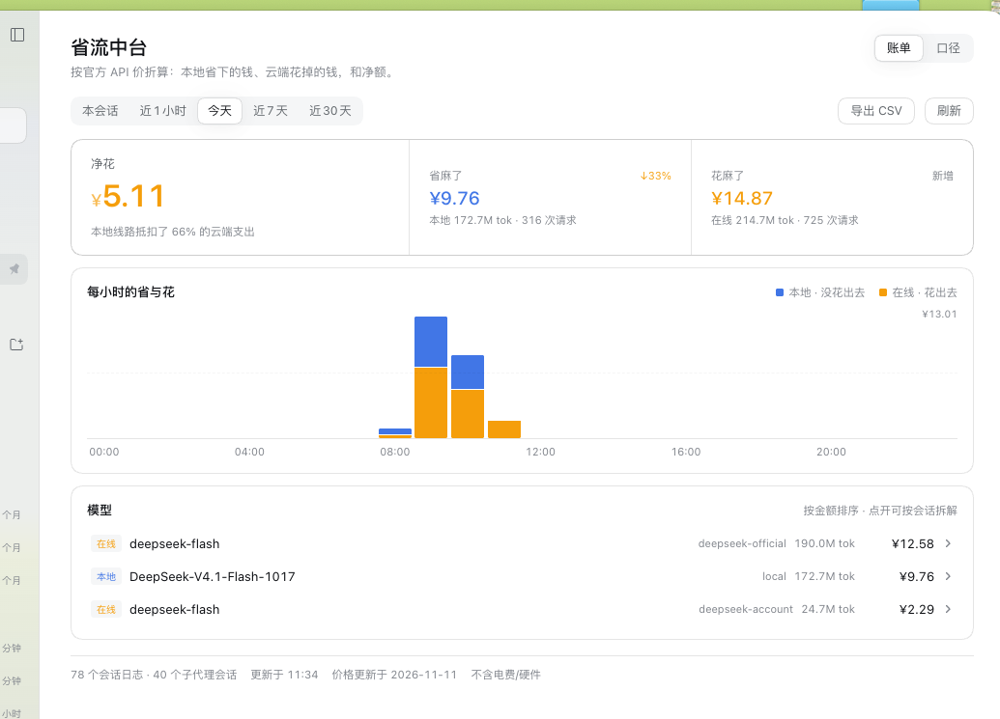
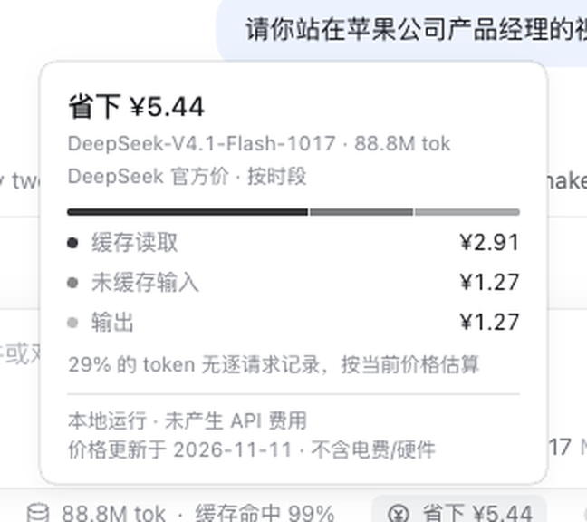
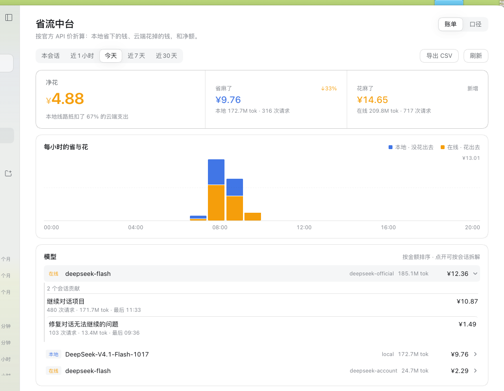
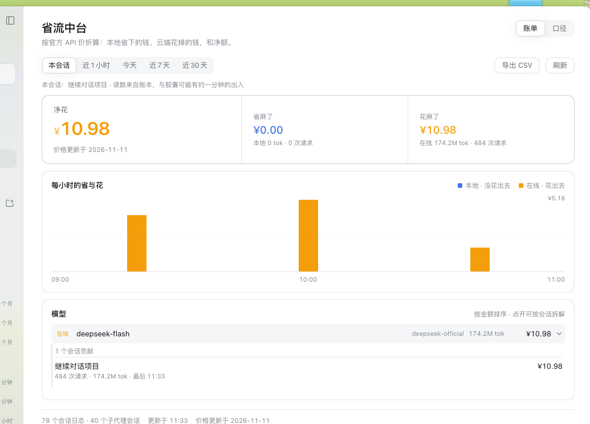
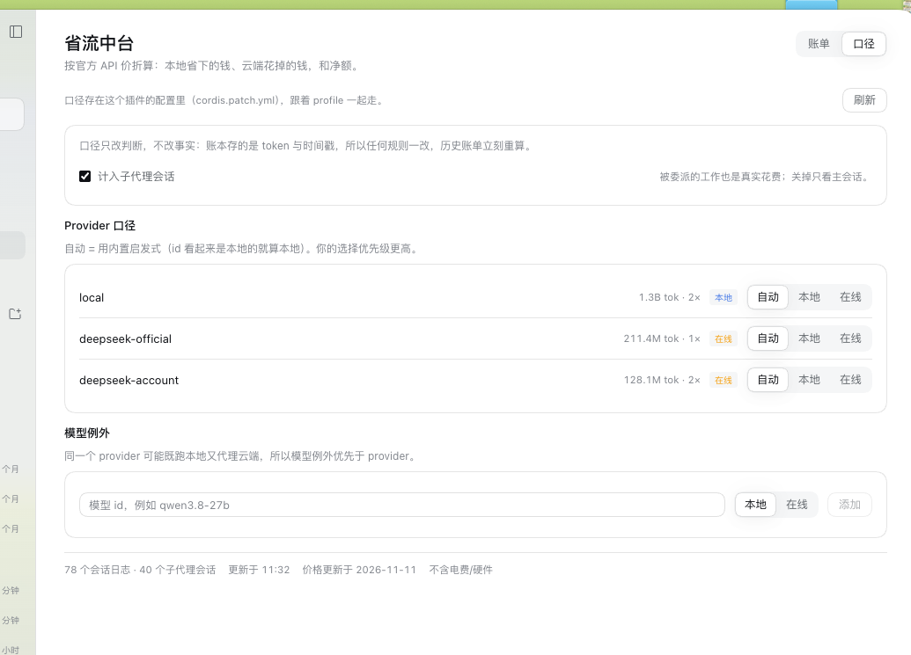
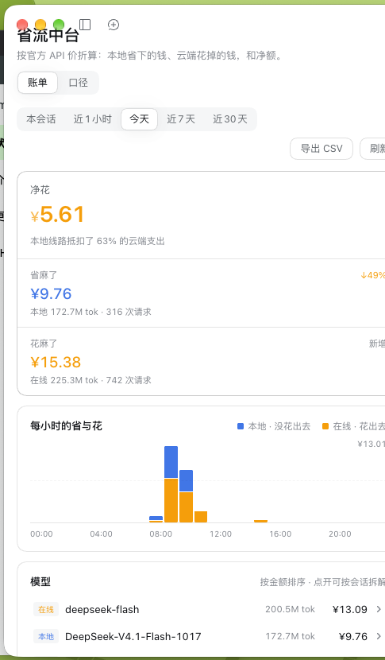
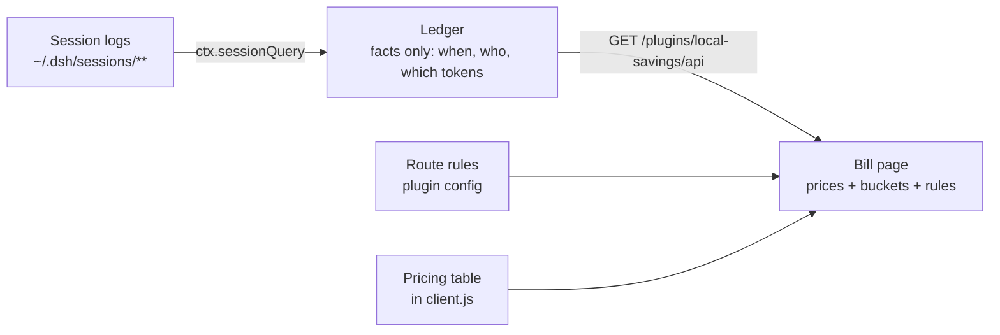

<div align="center">
  
  <h1>CostOps Hub · 省流中台</h1>
  <p><b>A token cost ledger for DeepSeek Harness.</b><br />
  Every settled request priced at the official list price that applied when it ran:<br />
  money <i>not spent</i> on a local route, money <i>spent</i> in the cloud, and the net between them.</p>

  <p>
    <a href="README.zh.md">简体中文</a> ·
    <b>English</b>
  </p>

  <p>
    
    
    
    
  </p>
</div>

<hr />



## Table of Contents

1. [Why](#1-why)
2. [What it looks like](#2-what-it-looks-like)
3. [How it works](#3-how-it-works)
4. [Install](#4-install)
5. [Use it](#5-use-it)
6. [Prices and accuracy](#6-prices-and-accuracy)
7. [Configuration](#7-configuration)
8. [Data and privacy](#8-data-and-privacy)
9. [Compatibility](#9-compatibility)
10. [Development](#10-development)
11. [License](#11-license)

## 1. Why

A local model feels free because no invoice arrives. It is not free: it costs electricity,
hardware, and the time you waited. What it *does* save is the API bill you would have paid for
the same tokens.

CostOps Hub answers one question with a ledger instead of a guess: **how much money did my local
routes actually save me, how much did the cloud routes actually cost, and what is the net?**

- It reads the session logs DeepSeek Harness already writes. No proxy, no interception, no
  network calls, nothing sent anywhere.
- It prices each request at the list price of the model that produced it, **at the moment it ran** —
  so a request that ran during off-peak hours keeps its off-peak price forever.
- It keeps **facts, not money**: timestamps, provider, model and four token buckets. Prices,
  exchange rates and the "is this route local?" verdict are views computed on the spot. Change a
  price or a rule and every past bill recalculates itself.

## 2. What it looks like

The bill page is the main surface; the composer pill is the live one.

| | |
| :---: | :---: |
|  <br /> **The pill** — one claim for the session you are in: `saved ¥5.51`, `spent ¥0.72`, or both. |  <br /> **Its breakdown** — the model, the price window, and where the money went. |
|  <br /> **Ask which session** — open any model and see the sessions that contributed, by amount. |  <br /> **This session** — the same three numbers for one conversation, and a way back. |

| | |
| :---: | :---: |
|  <br /> **Route rules** — which providers are local, which models are exceptions, whether sub-agents count. |  <br /> **It folds** — the summary bar stacks, the provider column drops out, the toolbar wraps. |

## 3. How it works



1. **Scan.** The Host half reads replayed session logs through `ctx.sessionQuery` (it owns zstd
   decoding, format migration and replay validation). Each settled `assistant/message` carries its
   provider, model and token usage, so attribution is exact per request, not per session.
2. **Book.** One fact row per settled request: `[time, session, seq, provider, model, uncached input,
   cache read, cache write, output]`. Forks are de-duplicated (`inheritedEventCount`), live sessions
   are re-read at most once a minute, and a scan stops at a wall-clock budget so the app never
   freezes — the page shows progress instead.
3. **Price.** The browser turns facts into money with the shipped price table and the route rules.
   Money is a view: nothing is stored in currency, so a price edit or a rule change re-renders every
   historical bill without rescanning a single log.

### What the ledger stores

| Stored | Not stored |
| --- | --- |
| Timestamp, session id, event seq | Money, currency, exchange rate |
| Provider id, model id | Peak / off-peak verdict |
| Uncached input, cache read, cache write, output tokens | "Local or cloud" verdict, price tier |

### A fresh install catches up on its own

The first open backfills the last 32 days of session logs, newest first, a few seconds at a time,
and reports `reading history 12/49 sessions…` while it does. Once covered, a session is only re-read
when its log changed.

## 4. Install

CostOps Hub is a DeepSeek Harness **bundle** — a package with a `dsh.bundle.patch` that inserts its
Host row and a browser module. Nothing else is required: no npm dependencies, no build step.

**From a checkout**

1. Clone the repository anywhere.
2. In DeepSeek Harness open **Plugins → Add plugin** and pick the directory, or install it with the
   `plugin_manager` tool using the absolute path.
3. Enable **CostOps Hub / 省流中台** in the plugin list.
4. The pill appears in the composer dock; the full page opens from **省流中台** in the left sidebar.

**From the repository URL**

Use the same `plugin_manager` install flow with the repository address instead of a path.

> The Host half is loaded once per plugin process. After changing `index.js`, reload the plugin row
> (disable and enable it in **Plugins**) — a browser reload alone is not enough.

## 5. Use it

### Windows

| Window | What it contains |
| --- | --- |
| **This session** | The conversation in front of you, and a link back to it after you drill elsewhere |
| **Last hour** | The last 60 minutes, in 5-minute buckets |
| **Today** | Beijing midnight to now, hourly buckets |
| **Last 7 days** | Seven Beijing days, one bucket per day |
| **Last 30 days** | Thirty days, the widest window the ledger keeps |

Every number carries a **comparison chip** against the previous equal window (this morning against
yesterday morning, this week against the week before). Saving more reads blue, spending more reads
amber; a window with no history says `new` instead of inventing a percentage.

### Reading the page

- **The summary bar** puts the net first and its two parts beside it, so the answer comes before the
  evidence.
- **The trend** stacks local savings (blue) over cloud spend (amber). Hover or tab to a bucket for a
  readout with that period's two amounts.
- **The models table** is sorted by money. Open a row to see the sessions behind it, then open a
  session to switch the whole page to that session's bill.
- **Export CSV** writes the current window's model × provider table — four token buckets, totals and
  amounts — into the plugin data folder and shows you the path.

### Route rules

The second tab decides what counts as local: per-provider verdicts (auto / local / cloud), model
exceptions (one provider can serve both worlds), and whether sub-agent sessions are included. Rules
change the *verdict*, never the facts — history is recalculated immediately.

### The pill

The composer pill is the live surface: it reads the session's own projections and trajectory, prices
each request when it ran, and reports `saved`, `spent`, or both. Click it for the breakdown.

## 6. Prices and accuracy

Prices are per 1,000,000 tokens, taken on **2026-11-11** from official vendor pages. Machine-readable
data and per-tier notes live in [`docs/pricing-source.json`](docs/pricing-source.json) and
[`docs/pricing-research.md`](docs/pricing-research.md); every surface states the date.

| Vendor | Covered | Notes |
| --- | --- | --- |
| **DeepSeek** | deepseek-flash ≈ `DeepSeek-V4.1-Flash-1017`, deepseek-v4-pro | CNY; peak 09:00–12:00 and 14:00–18:00 Beijing time, 50% off outside |
| **Zhipu** | GLM-5.3 / 5.3-Flash / 5.3-FlashX / GLM-5.x / GLM-4.x | CNY; approximated tiers are labelled |
| **Alibaba** | `qwen3.8-27b` (Beijing list price), qwen3.8-max, qwen3.8-flash | USD list prices converted at 1:6.67 |
| **Moonshot** | Kimi | official page publishes no machine-readable price — tokens only |

Known limits, all surfaced in the UI rather than hidden:

- A model with no published price still counts tokens and says so; amounts stay blank.
- Model ids are canonicalised (`-Instruct`, `-AWQ`, `-EXL3`, `-GGUF`, `-FP8`, `-4bit` …) so a
  quantised artifact is priced as its official tier without an approximation notice.
- DeepSeek's peak/off-peak boundaries are modelled; Chinese public holidays are not.
- Local savings exclude electricity and hardware — the footer says so on every page.

## 7. Configuration

Route rules live in this plugin's row of the profile patch, so they travel with the profile and are
visible to the Settings/Plugins surface:

```yaml
- id: local-savings
  name: "@local/dsh-local-savings"
  config:
    version: 1
    includeSubagents: true
    providers:
      local: local
      deepseek-official: cloud
    models:
      qwen3.8-27b: local
```

A profile without `configEditor` (headless runs) falls back to
`<DSH_HOME>/storages/local-savings/rules.v1.json`; both reads and writes report which source was
used, and the page states it.

## 8. Data and privacy

| Item | Location |
| --- | --- |
| Session logs (read only) | `<DSH_HOME>/sessions/**` |
| Ledger | `<DSH_HOME>/storages/local-savings/facts.v1.json` |
| Exported CSV | `<DSH_HOME>/storages/local-savings/exports/` |
| Route rules | the profile's `cordis.patch.yml` |

The plugin makes **no network requests**. It has no telemetry, no accounts, no proxy. The only data
it sends anywhere is the JSON it serves to its own page over the harness's loopback HTTP server. If
you delete the ledger file, the next open rebuilds it from the session logs.

## 9. Compatibility

- DeepSeek Harness Desktop **0.2.x** (the bundle targets the `conversation.composer.dock`,
  `sidebar.panellist` and `main` slots, and the `sessionQuery` / `webServer` / `configEditor` Host
  services).
- macOS is what it was built and tested on; the UI is plain web and the Host half uses Node built-ins
  only, so other platforms run the same code.
- Two Host capabilities are optional by design: without `configEditor` the rules fall back to a side
  file; without `sessionQuery` the page reports that history cannot be read.

## 10. Development

Everything is plain JavaScript — no dependencies, no bundler, no TypeScript step.

```bash
node --check index.js && node --check client.js

node tools/host-smoke.mjs          # 12  Host: ledger folding, forks, coverage, export bounds
node tools/host-config-smoke.mjs   # 4   Host: row config ↔ rules, editor round-trip, fallback
node tools/test-client.mjs         # 106 Client: pill, page, windows, drills, readouts, degradation
node tools/detail-check.mjs        # 6   Plugin Manager detail resources
node tools/live-log-check.mjs 3    # real session logs through the real route
```

The suites run without DeepSeek Harness: a fake Cordis context drives the Host half, and a small
React shim with a hook store renders the browser half. CI runs the first four on every push.

| File | Role |
| --- | --- |
| `index.js` | Host half: ledger, rules, one HTTP route |
| `client.js` | Browser half: the pill and the bill page |
| `cordis.patch.yml` | Bundle patch that inserts the Host row |
| `locale/` | Plugin Manager title, description and detail document |
| `tools/` | Test suites and the detail-resource check |
| `docs/client-api-findings.md` | What each shipped API actually does, verified against a live build |

## 11. License

[MIT](LICENSE) © 2026 Ivan Yin.

<hr />

<div align="center">
  <sub>降本增效，省麻了 — cost down, efficiency up.</sub>
</div>
