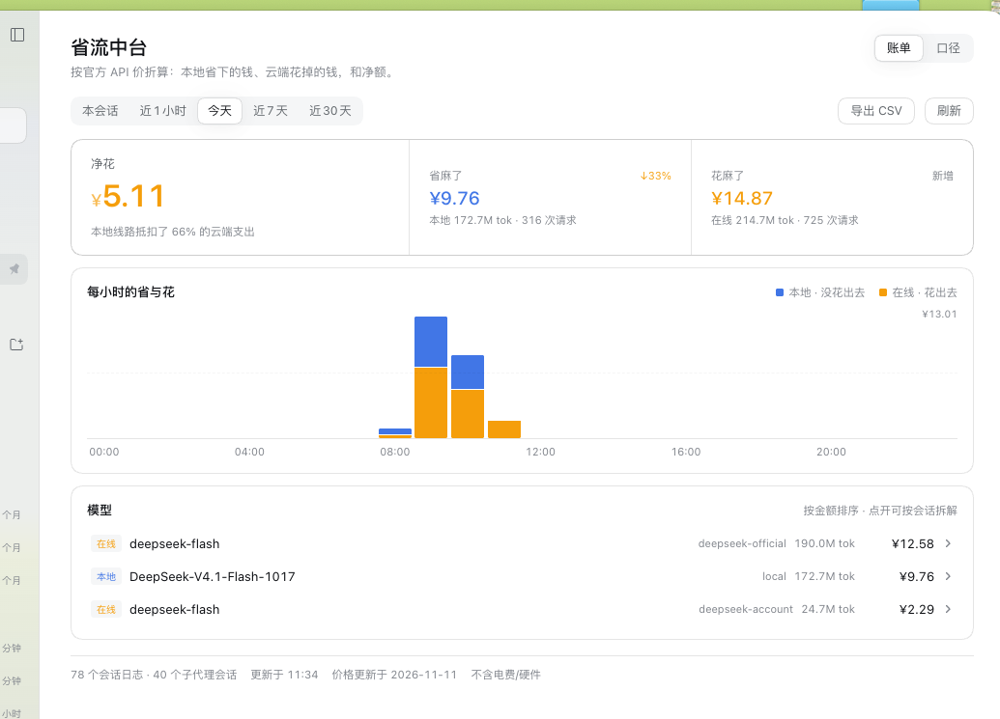
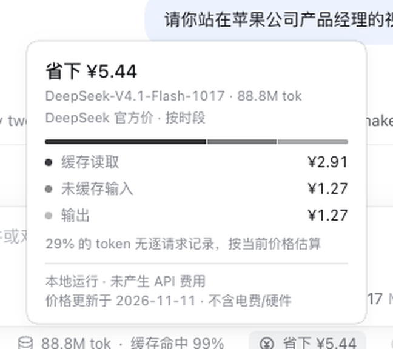
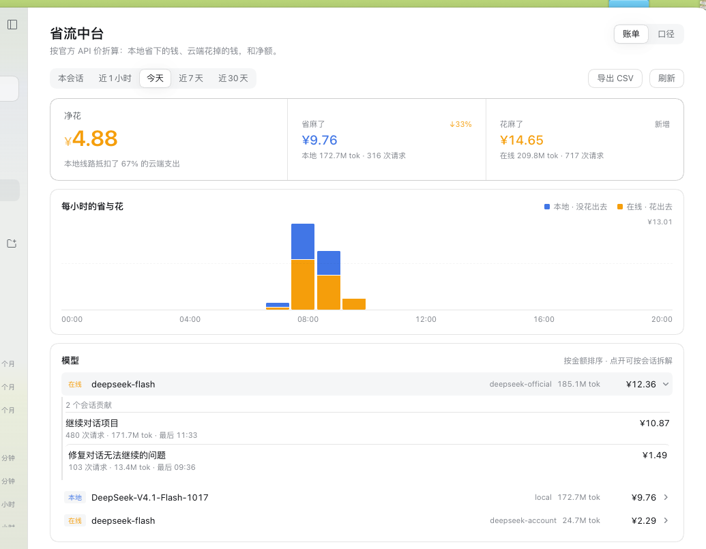
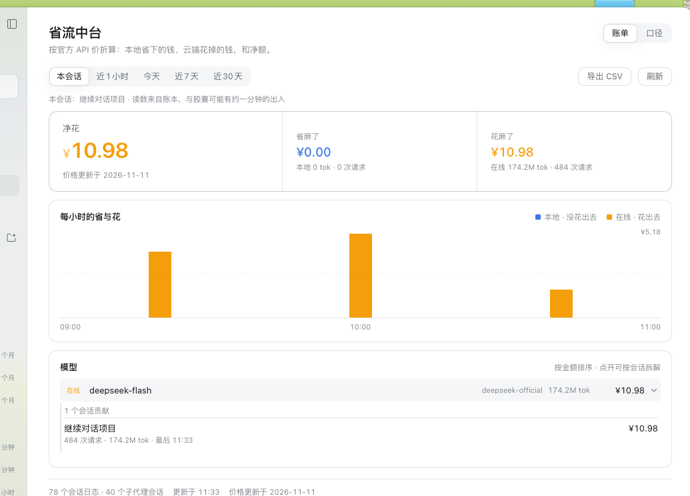
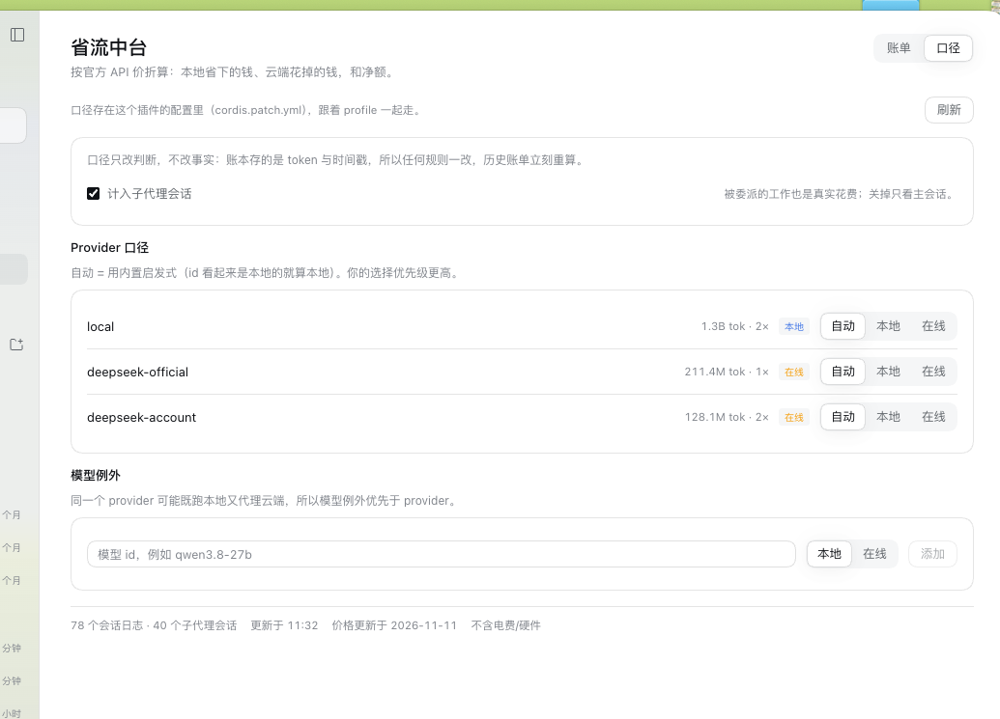
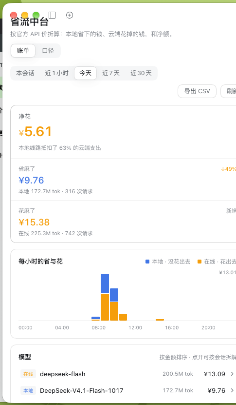
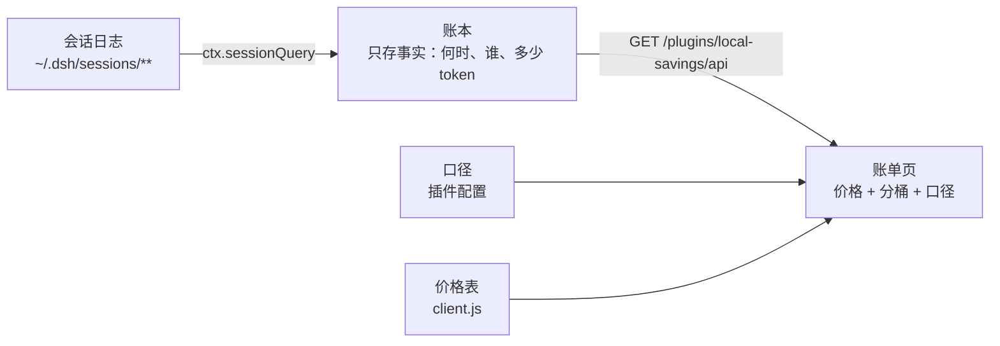

<div align="center">
  
  <h1>省流中台 · CostOps Hub</h1>
  <p><b>DeepSeek Harness 的 Token 成本账本。</b><br />
  每个已结算的请求，按它<b>跑的那一刻</b>的官方价折算：<br />
  本地线路<b>没花出去</b>的钱、云端线路<b>花掉</b>的钱，以及两者之差。</p>

  <p>
    <b>简体中文</b> ·
    <a href="README.md">English</a>
  </p>

  <p>
    
    
    
    
  </p>
</div>

<hr />



## 目录

1. [为什么要有它](#1-为什么要有它)
2. [界面](#2-界面)
3. [工作原理](#3-工作原理)
4. [安装](#4-安装)
5. [使用](#5-使用)
6. [价格与口径](#6-价格与口径)
7. [配置](#7-配置)
8. [数据与隐私](#8-数据与隐私)
9. [兼容性](#9-兼容性)
10. [开发](#10-开发)
11. [许可证](#11-许可证)

## 1. 为什么要有它

本地模型看起来是免费的，因为没有人给你寄账单。但它并不免费：电费、硬件、你等它出字的时间都是成本。
它真正省下的，是"同样这些 token 如果走 API 要付的钱"。

省流中台只回答一个问题，而且用账本回答而不是用感觉：**这个月本地线路到底省了多少、云端线路到底花了多少、
净额是多少？**

- 它读的是 DeepSeek Harness 本来就写在磁盘上的会话日志。没有代理、没有截流、不联网、不外发。
- 每个请求按**产出它的那个模型**的官方价、按**它运行的那一刻**计价——高峰期跑的就永远按高峰价算，
  不会因为时钟跨过 12:00 就自己变便宜。
- 它只存**事实**，不存钱：时间戳、provider、模型、四类 token。价格、汇率、"这算不算本地"都是即时计算的视图。
  改一次价格或一条口径，历史账单立刻重算。

## 2. 界面

账单页是主界面，输入栏胶囊是实时界面。

| | |
| :---: | :---: |
|  <br /> **胶囊** —— 只对当前会话下一个结论：`省下 ¥5.51`、`花费 ¥0.72`，或者两者都有。 |  <br /> **点开的明细** —— 是哪个模型、哪个价格时段、钱花在哪一类 token 上。 |
|  <br /> **看到会话** —— 展开任一模型，按金额列出贡献它的会话。 |  <br /> **本会话档** —— 同一个对话的三个数，以及从别处跳回来的回路。 |

| | |
| :---: | :---: |
|  <br /> **口径** —— 哪些 provider 算本地、哪些模型是例外、算不算子代理。 |  <br /> **会折行** —— 摘要带竖排、provider 列隐藏、工具栏换行。 |

## 3. 工作原理



1. **扫描。** Host 半通过 `ctx.sessionQuery` 读会话日志（zstd 多帧解码、格式迁移、replay 校验都由它负责）。
   每条已结算的 `assistant/message` 都自带 provider、model 和 token 用量，所以归属是**按请求**的，不是按会话猜的。
2. **记账。** 一个已结算请求一行事实：`[时间, 会话, seq, provider, model, 未缓存输入, 缓存读, 缓存写, 输出]`。
   fork 出来的会话按 `inheritedEventCount` 去掉继承部分；活会话最多每分钟重读一次；扫描按时间预算分批，
   不会把应用卡住——页面显示进度而不是转圈。
3. **计价。** 浏览器用内置价格表和口径把事实折成钱。钱是视图：账本里没有任何货币字段，所以改价格、改口径
   都能立刻重算历史，而不用重扫一条日志。

### 账本存什么、不存什么

| 存 | 不存 |
| --- | --- |
| 时间戳、会话 id、事件 seq | 金额、货币、汇率 |
| provider id、模型 id | 高峰/低谷判定 |
| 未缓存输入、缓存读、缓存写、输出 token | "本地还是云端"判定、价格档位 |

### 新装也能自己追平

第一次打开会从最近 32 天的日志开始，从新到旧、每次几秒地回填，并显示 `正在回溯 12/49 个会话…`。
追平之后，只有日志变过的会话才会被重读。

## 4. 安装

省流中台是一个 DeepSeek Harness **bundle**——带 `dsh.bundle.patch` 的包，会插入自己的 Host 行和浏览器模块。
没有 npm 依赖，没有构建步骤。

**从本地目录安装**

1. 把仓库克隆到任意位置。
2. 在 DeepSeek Harness 里打开 **插件 → 添加插件**，选择这个目录；或用 `plugin_manager` 工具传绝对路径安装。
3. 在插件列表里启用 **省流中台 / CostOps Hub**。
4. 胶囊出现在输入栏；完整页面从左栏的 **省流中台** 进入。

**从仓库地址安装**

用同样的 `plugin_manager` 流程，把地址换成仓库 URL 即可。

> Host 半在每个插件进程里只加载一次。改完 `index.js` 要在 **插件** 里把这一行关掉再打开——
> 只刷新浏览器不够。

## 5. 使用

### 五个窗口

| 窗口 | 内容 |
| --- | --- |
| **本会话** | 眼前这个对话；从别处下钻过来后，这里有一条回到当前会话的链接 |
| **近1小时** | 最近 60 分钟，5 分钟一个桶 |
| **今天** | 北京时间 0 点到现在，按小时分桶 |
| **近7天** | 七个自然日，一天一个桶 |
| **近30天** | 三十天，账本保留的最宽窗口 |

每个数字右上角都有一枚**环比标记**，和"上一个等长窗口"比（今天早上比昨天早上、这周比上周）。
省得更多是蓝、花得更多是橙；上期没有数就标"新增"，不硬凑百分比。

### 怎么读这一页

- **摘要带**：净额放在最前、最大，两个来源跟在旁边——先给结论，再给证据。
- **趋势**：本地省下（蓝）叠在云端花掉（橙）之上。鼠标悬停或 Tab 到某根柱子，浮出该时段的两个金额。
- **模型表**：按金额排序。展开一行看它由哪些会话贡献，再点某个会话，整页切到那个会话的账单。
- **导出 CSV**：把当前窗口的「模型 × provider」表——四类 token、合计、金额——写进插件数据目录，并把路径显示出来。

### 口径

第二个标签页决定"什么算本地"：provider 三态（自动 / 本地 / 在线）、模型例外（同一个 provider 可能两种都跑）、
是否计入子代理会话。口径只改**判断**，不改事实——历史立刻重算。

### 胶囊

输入栏的胶囊是实时界面：直接读当前会话的 projection 和 trajectory，按请求各自的时间计价，报 `省下`、`花费`，
或两者。点开看明细。

## 6. 价格与口径

价格单位是"每 100 万 token"，取值日期 **2026-11-11**，来自各家官方页面。机器可读的数据和每个档位的说明在
[`docs/pricing-source.json`](docs/pricing-source.json) 和 [`docs/pricing-research.md`](docs/pricing-research.md)，
每个界面都会写出这个日期。

| 厂商 | 覆盖 | 说明 |
| --- | --- | --- |
| **DeepSeek** | deepseek-flash ≈ `DeepSeek-V4.1-Flash-1017`、deepseek-v4-pro | 人民币；北京时间 9:00–12:00、14:00–18:00 为高峰，其余时段五折 |
| **智谱** | GLM-5.3 / 5.3-Flash / 5.3-FlashX / GLM-5.x / GLM-4.x | 人民币；近似档位会标注 |
| **阿里** | `qwen3.8-27b`（华北2 北京价）、qwen3.8-max、qwen3.8-flash | 美元价按 1:6.67 折算 |
| **月之暗面** | Kimi | 官方页没有机器可读价格——只计 token |

已知边界，全部在界面上说明而不是藏起来：

- 没有公开价格的模型照样计 token，并写明"未计价"，金额留空。
- 模型 id 会做归一化（`-Instruct`、`-AWQ`、`-EXL3`、`-GGUF`、`-FP8`、`-4bit` …），量化版按同档官方价计，
  但不会误标成"近似档位"。
- DeepSeek 的峰谷边界有建模，中国法定节假日没有。
- 本地省下的钱不含电费与硬件——每个页面页脚都写着这句。

## 7. 配置

口径存在插件在 profile 配置里的那一行，所以跟着 profile 走，也能在设置/插件界面里看到：

```yaml
- id: local-savings
  name: "@local/dsh-local-savings"
  config:
    version: 1
    includeSubagents: true
    providers:
      local: local
      deepseek-official: cloud
    models:
      qwen3.8-27b: local
```

没有 `configEditor` 的 profile（headless）会回退到
`<DSH_HOME>/storages/local-savings/rules.v1.json`；读写都会返回用的是哪个来源，页面如实标注。

## 8. 数据与隐私

| 内容 | 位置 |
| --- | --- |
| 会话日志（只读） | `<DSH_HOME>/sessions/**` |
| 账本 | `<DSH_HOME>/storages/local-savings/facts.v1.json` |
| 导出的 CSV | `<DSH_HOME>/storages/local-savings/exports/` |
| 口径 | profile 的 `cordis.patch.yml` |

插件**不发起任何网络请求**：没有遥测、没有账号、没有代理。它唯一"发出去"的数据，是通过 harness 自己的
回环 HTTP 服务发给自己的页面。删掉账本文件，下次打开会从会话日志重建。

## 9. 兼容性

- DeepSeek Harness Desktop **0.2.x**（用到了 `conversation.composer.dock`、`sidebar.panellist`、`main` 三个槽，
  以及 `sessionQuery` / `webServer` / `configEditor` 三个 Host 服务）。
- 在 macOS 上开发和验证；界面是普通 Web，Host 半只用 Node 内置模块，其他平台跑同一份代码。
- 两个 Host 能力是可选的：没有 `configEditor` 时口径回退到文件；没有 `sessionQuery` 时页面会明说读不到历史。

## 10. 开发

全部是普通 JavaScript——没有依赖、没有打包、没有 TypeScript 步骤。

```bash
node --check index.js && node --check client.js

node tools/host-smoke.mjs          # 12  Host：事实折叠、fork、覆盖进度、导出边界
node tools/host-config-smoke.mjs   # 4   Host：行配置 ↔ 口径、编辑器往返、回退
node tools/test-client.mjs         # 106 Client：胶囊、页面、窗口、下钻、浮层、降级
node tools/detail-check.mjs        # 6   插件详情资源
node tools/live-log-check.mjs 3    # 用真实会话日志跑一遍真实路由
```

这些套件不需要启动 DeepSeek Harness：一个假的 Cordis context 驱动 Host 半，一个带 hook store 的
小型 React shim 渲染浏览器半。CI 在每次推送时跑前四个。

| 文件 | 作用 |
| --- | --- |
| `index.js` | Host 半：账本、口径、一条 HTTP 路由 |
| `client.js` | 浏览器半：胶囊与账单页 |
| `cordis.patch.yml` | 插入 Host 行的 bundle patch |
| `locale/` | 插件管理器的标题、描述与详情文档 |
| `tools/` | 测试套件与详情资源检查 |
| `docs/client-api-findings.md` | 每个用到的官方接口到底怎么工作，逐条对着真实构建核实过 |

## 11. 许可证

[MIT](LICENSE) © 2026 Ivan Yin。

<hr />

<div align="center">
  <sub>降本增效，省麻了。</sub>
</div>
